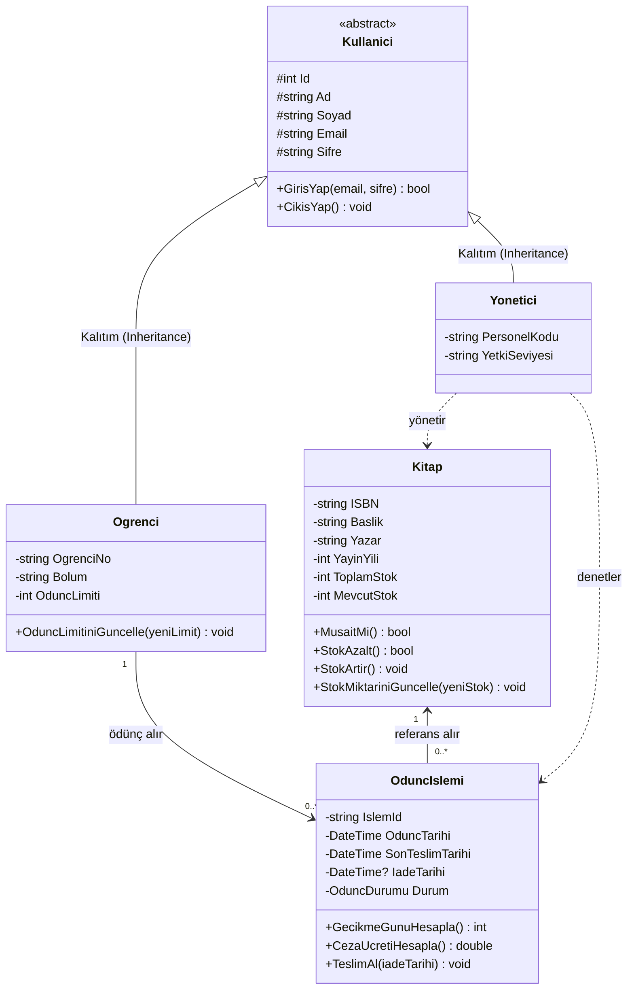
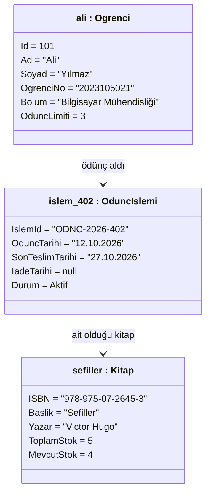

# 📚 Üniversite Kütüphane Yönetim Sistemi (UML & C# Clean Architecture)

[](https://dotnet.microsoft.com/)
[](https://docs.microsoft.com/en-us/dotnet/csharp/)
[]()
[]()

Bir üniversite kütüphanesinin temel gereksinimlerini (kitap arama, ödünç alma, iade, stok takibi, gecikme ve ceza raporlama, kitap ekleme/düzenleme) karşılamak üzere Nesne Yönelimli Programlama (OOP) ve Katmanlı Mimari prensipleriyle geliştirilmiş C# projesi.

---

## 🏛️ 1. Mimari ve Katman Dağılımı (Logical Architecture)

Proje, yazılım mühendisliği standartlarına uygun olarak 3 temel mantıksal pakete (katmana) ayrılmıştır:

```
KutuphaneOtomasyonu/
│
├── .gitignore
├── README.md
├── KutuphaneOtomasyonu.sln
│
└── src/
    └── KutuphaneOtomasyonu.App/
        ├── KutuphaneOtomasyonu.App.csproj
        ├── Program.cs                        # Sunum Katmanı (Presentation Layer - CLI UI)
        │
        ├── Domain/                           # Çekirdek İş Varlıkları (Core Domain)
        │   ├── Entities/
        │   │   ├── Base/
        │   │   │   └── Kullanici.cs          # Soyut Üst Sınıf (Inheritance)
        │   │   ├── Ogrenci.cs                # Öğrenci Üye Varlığı
        │   │   ├── Yonetici.cs               # Kütüphane Yöneticisi Varlığı
        │   │   ├── Kitap.cs                  # Kitap ve Stok Varlığı
        │   │   └── OduncIslemi.cs            # Ödünç Alma & Ceza Hesabı Varlığı
        │   └── Enums/
        │       └── OduncDurumu.cs            # Aktif, IadeEdildi, Gecikmis
        │
        ├── DataAccess/                       # Veri Erişim Katmanı (DAL - Repository Pattern)
        │   ├── Interfaces/
        │   │   ├── IKitapRepository.cs
        │   │   ├── IOduncRepository.cs
        │   │   └── IKullaniciRepository.cs
        │   └── Repositories/
        │       ├── InMemoryKitapRepository.cs
        │       ├── InMemoryOduncRepository.cs
        │       └── InMemoryKullaniciRepository.cs
        │
        └── BusinessLogic/                    # İş Mantığı Katmanı (Services)
            ├── Interfaces/
            │   ├── IKitapServisi.cs
            │   ├── IOduncServisi.cs
            │   └── IRaporServisi.cs
            └── Services/
                ├── KitapServisi.cs
                ├── OduncServisi.cs
                └── RaporServisi.cs
```

---

## 📊 2. UML Diyagramları

### A. Sınıf Diyagramı (Class Diagram)



### B. Somut Nesne Diyagramı (Object Diagram)
*Ali Yılmaz adlı öğrencinin "Sefiller" kitabını ödünç aldığı anın bellekteki durumu:*



---

## ⚡ 3. Öne Çıkan Özellikler

* **Katalog & Stok Yönetimi:** Kitapların raftaki mevcut stoku ve toplam stoku ayrı izlenir. Kitap ödünç verildiğinde stok otomatik düşer, iade edildiğinde artar.
* **Ödünç Alma & Limit Kuralları:** Öğrencinin ödünç limiti (varsayılan: 3) denetlenir. Öğrencinin üzerinde teslim süresi geçmiş kitap varsa ceza ödenmeden yeni kitap verilmez.
* **Gecikme & Ceza Motoru:** Son teslim tarihini geçen her gün için otomatik ceza (günlük 5 TL) hesaplanır.
* **Yönetici Paneli:** Yeni kitap ekleme, stok güncelleme, kütüphane genel istatistikleri ve geciken kitaplar için raporlama ekranı.
* **Canlı UML Simülasyonu:** Menüdeki 10. seçenek ile UML Object Diagram senaryosu (Ali'nin Sefiller'i alması) tek tıkla simüle edilip bellek durumu ekrana yazdırılır.

---

## 🚀 4. Kurulum ve Çalıştırma

### Gereksinimler
* [.NET 8.0 SDK](https://dotnet.microsoft.com/download/dotnet/8.0) veya üzeri

### Adımlar

1. **Projeyi klonlayın:**
   ```bash
   git clone https://github.com/enveralas/KutuphaneOtomasyonu.git
   cd KutuphaneOtomasyonu
   ```

2. **Projeyi derleyin:**
   ```bash
   dotnet build
   ```

3. **Uygulamayı çalıştırın:**
   ```bash
   dotnet run --project src/KutuphaneOtomasyonu.App
   ```

---

## 📝 Lisans

Bu proje [MIT](LICENSE) lisansı ile lisanslanmıştır. Eğitim ve akademik projelerde serbestçe kullanılabilir.
